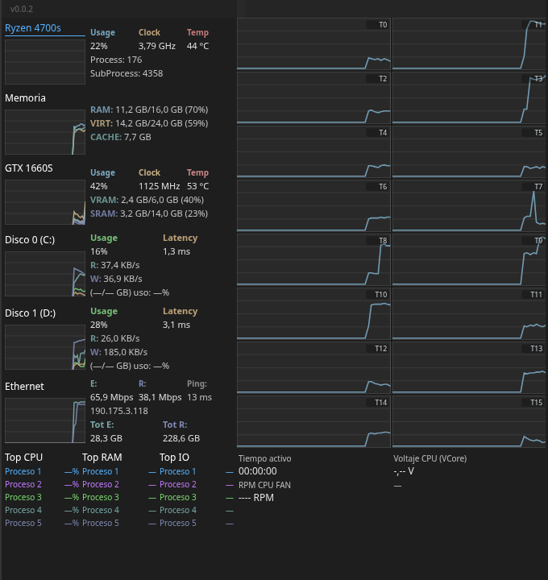

# Rainmeter WebView Panel

Un widget de monitoreo de hardware que combina **Rainmeter**, una interfaz **HTML/CSS/JavaScript** y un host **WebView2**. Muestra CPU, memoria, GPU, discos y red, con gráficos de actividad y navegación entre paneles.

**Estado:** proyecto personal terminado. El repositorio conserva el alcance final del widget y el recorrido de aprendizaje; no representa una promesa de nuevas funcionalidades.



*Demo real en navegador sobre Linux, con datos simulados. No es una captura de sensores reales ni de la integración nativa de Windows. Algunos campos permanecen como placeholders.*

## Probalo sin instalar Rainmeter

1. Descargá o cloná este repositorio completo.
2. Abrí [`COMBINADO/index.html`](COMBINADO/index.html) en un navegador de escritorio.
3. Esperá unos segundos: el widget genera datos simulados para mostrar su funcionamiento sin acceso al hardware.

No requiere un proceso de compilación para esta demo. Conservá las rutas relativas: el HTML carga sus recursos desde `@Resources/web/`.

> La demo permite explorar el widget, no monitorear tu equipo desde el navegador. Los nombres de hardware y los valores mostrados no describen necesariamente tu máquina.

## Uso con Rainmeter

La integración real está pensada para **Windows**: Rainmeter aloja el skin, el plugin WebView carga la interfaz y las medidas suministran los datos. Parte de la telemetría usa el registro de HWiNFO y requiere adaptar los índices al equipo.

El proyecto utiliza un fork del plugin WebView. Este repositorio no incluye su binario ni una distribución verificada del fork: la demo web es la vía directa para probar el resultado sin esa dependencia.

## Qué hay en el repositorio

| Ruta | Responsabilidad |
| --- | --- |
| [`COMBINADO/`](COMBINADO/) | Skin de Rainmeter e interfaz HTML del widget. |
| [`@Resources/`](@Resources/) | Configuración de sensores, estilos y módulos JavaScript. |
| [`docs/`](docs/README.md) | Documentación del proyecto e historia del desarrollo. |
| [`docs/devlog/`](docs/devlog/README.md) | Artículos originales: problemas, experimentos y aprendizajes. |

## Alcance y límites

- La demo con mocks y la integración nativa son dos formas distintas de ejecutar la interfaz.
- La configuración de sensores refleja el equipo usado durante el desarrollo; no es autodetección universal de hardware.
- La interfaz conserva etiquetas y paneles del alcance final. Los datos simulados no cubren todos los campos.
- Los artículos del DevLog describen su momento histórico; no sustituyen la referencia técnica del estado actual.

## Comprobaciones locales

La demo no necesita Node.js. Para ejecutar las pruebas de regresión del arranque y del puente, desde la raíz y con Node.js disponible:

```sh
node --test @Resources/web/tests/*.test.cjs
```

Estas pruebas comprueban la selección de mocks, la protección de la UI simulada, los reintentos de arranque y la compatibilidad del puente mediante dobles de prueba. No sustituyen una ejecución de Rainmeter en Windows.

## Historia

El proyecto nació como una exploración de la integración entre Rainmeter, WebView2 y una interfaz web. Su [DevLog](docs/devlog/README.md) conserva ese recorrido, incluyendo pruebas, cambios de enfoque y decisiones tomadas durante el desarrollo. La [retrospectiva](docs/devlog/retrospective.md) resume los aprendizajes y el cierre del proyecto.
